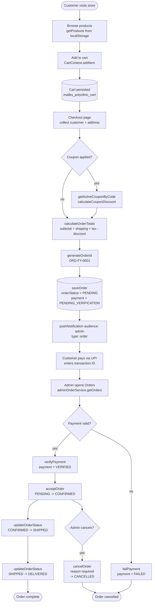
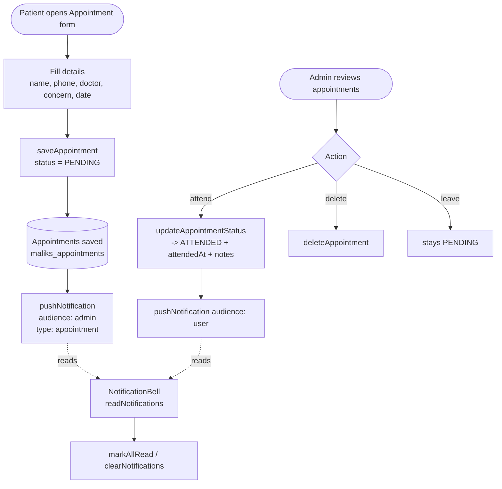
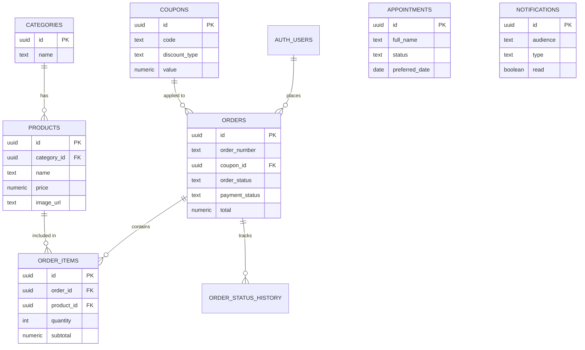

# Malik's Polyclinic — Database Design & Data Flow

> Generated by auditing every storage/service function in `src/`.
> **Current state:** all data lives in the browser's `localStorage` (a client-only
> "development adapter"). **Recommended target:** Supabase Postgres with the schema below.

---

## 1. Entities discovered in the code

| Entity | Source of truth today | Storage key | Core functions |
|--------|----------------------|-------------|----------------|
| **Product** | `utils/productStorage.js` | `maliks_products` | `getProducts`, `addProduct`, `updateProduct`, `deleteProduct` |
| **Product Category** | `utils/adminManagementStorage.js` | `maliks_product_categories` | `addCategory`, `updateCategory`, `deleteCategory` |
| **Coupon** | `utils/adminManagementStorage.js` | `maliks_coupons` | `addCoupon`, `updateCoupon`, `deleteCoupon`, `getActiveCouponByCode`, `calculateCouponDiscount` |
| **Order** (+ items, payment, status history) | `utils/orderStorage.js` | `maliks_orders` | `saveOrder`, `updateOrder`, `canonicalizeOrder`, `calculateOrderTotals`, `generateOrderId` |
| **Admin Order Actions** | `services/adminOrderService.js` | (wraps orderStorage) | `acceptOrder`, `updateOrderStatus`, `cancelOrder`, `verifyPayment`, `failPayment` |
| **Appointment** | `utils/appointmentStorage.js` | `maliks_appointments` | `saveAppointment`, `updateAppointmentStatus`, `deleteAppointment` |
| **Notification** | `utils/notificationStore.js` | `maliks_notifications` | `pushNotification`, `markAllRead`, `clearNotifications` |
| **Clinic Settings** | `utils/adminManagementStorage.js` | `maliks_clinic_settings` | `getClinicSettings`, `saveClinicSettings` |
| **Admin User** | `context/AuthContext.jsx` + Supabase Auth | `maliks_admin_session`, `maliks_registered_admins` | `login`, `signUp`, `loginDemo`, `logout`, `resetPassword` |
| **Cart** (session) | `context/CartContext.jsx` | `maliks_polyclinic_cart` | `addItem`, `increase`, `decrease`, `removeItem`, `clear` |

### Status enums found in code
- **Order status:** `PENDING → CONFIRMED → SHIPPED → DELIVERED` (+ `CANCELLED`)
- **Payment status:** `PENDING_VERIFICATION → VERIFIED` / `FAILED`
- **Appointment status:** `PENDING → ATTENDED`
- **Notification audience:** `admin | user | all`
- **Notification type:** `order | appointment | payment | product | success | warning | info`
- **Discount type:** `percent | fixed`

---

## 2. Recommended Supabase (Postgres) Schema

Relationships: an **Order** has many **order_items**; an **Order** references one **Coupon**;
an **order_item** references one **Product**; a **Product** references one **category**.
Admin users live in Supabase's built-in `auth.users`.

```sql
-- CATEGORY ---------------------------------------------------------------
create table categories (
  id          uuid primary key default gen_random_uuid(),
  name        text not null unique,
  created_at  timestamptz not null default now()
);

-- PRODUCT ----------------------------------------------------------------
create table products (
  id           uuid primary key default gen_random_uuid(),
  category_id  uuid references categories(id) on delete set null,
  name         text not null,
  description  text default '',
  price        numeric(10,2) not null check (price >= 0),
  image_url    text,                       -- Supabase Storage URL
  is_active    boolean not null default true,
  created_at   timestamptz not null default now(),
  updated_at   timestamptz not null default now()
);

-- COUPON -----------------------------------------------------------------
create table coupons (
  id            uuid primary key default gen_random_uuid(),
  code          text not null unique,
  discount_type text not null check (discount_type in ('percent','fixed')),
  value         numeric(10,2) not null check (value > 0),
  active        boolean not null default true,
  expires_on    date,
  created_at    timestamptz not null default now()
);
```


-- ORDERS -----------------------------------------------------------------
create table orders (
  id                uuid primary key default gen_random_uuid(),
  order_number      text not null unique,   -- e.g. ORD-26-27-0001
  user_id           uuid references auth.users(id) on delete set null,
  customer_name     text not null,
  customer_phone    text not null,
  customer_email    text,
  address_line      text not null,
  city              text not null,
  state             text not null,
  pincode           text not null,
  country           text not null default 'India',
  notes             text default '',
  coupon_id         uuid references coupons(id) on delete set null,
  coupon_code       text,
  subtotal          numeric(10,2) not null default 0,
  shipping          numeric(10,2) not null default 0,
  tax               numeric(10,2) not null default 0,
  discount          numeric(10,2) not null default 0,
  total             numeric(10,2) not null default 0,
  payment_method    text,
  payment_status    text not null default 'PENDING_VERIFICATION'
                    check (payment_status in ('PENDING_VERIFICATION','VERIFIED','FAILED')),
  transaction_id    text,
  verified_at       timestamptz,
  failed_at         timestamptz,
  verified_by       uuid,
  order_status      text not null default 'PENDING'
                    check (order_status in ('PENDING','CONFIRMED','SHIPPED','DELIVERED','CANCELLED')),
  cancel_reason     text,
  cancelled_at      timestamptz,
  created_at        timestamptz not null default now(),
  updated_at        timestamptz not null default now()
);

-- ORDER ITEMS (normalized; the app currently stores these inline) --------
create table order_items (
  id          uuid primary key default gen_random_uuid(),
  order_id    uuid not null references orders(id) on delete cascade,
  product_id  uuid references products(id) on delete set null,
  name        text not null,                -- snapshot of name at purchase time
  price       numeric(10,2) not null,
  quantity    int  not null check (quantity > 0),
  subtotal    numeric(10,2) not null
);

-- ORDER STATUS HISTORY (from statusHistory[]) ----------------------------
create table order_status_history (
  id         uuid primary key default gen_random_uuid(),
  order_id   uuid not null references orders(id) on delete cascade,
  status     text not null,
  changed_at timestamptz not null default now(),
  changed_by uuid

-- APPOINTMENTS -----------------------------------------------------------
create table appointments (
  id             uuid primary key default gen_random_uuid(),
  full_name      text not null,
  phone          text not null,
  email          text,
  doctor         text not null,
  concern        text not null,
  preferred_date date not null,
  message        text default '',
  status         text not null default 'PENDING'
                 check (status in ('PENDING','ATTENDED','CANCELLED')),
  attended_at    timestamptz,
  notes          text default '',
  created_at     timestamptz not null default now(),
  updated_at     timestamptz not null default now()
);

-- NOTIFICATIONS ----------------------------------------------------------
create table notifications (
  id         uuid primary key default gen_random_uuid(),
  audience   text not null check (audience in ('admin','user','all')),
  type       text not null,
  title      text not null,
  message    text not null default '',
  meta       jsonb default '{}',
  read       boolean not null default false,
  created_at timestamptz not null default now()
);

-- CLINIC SETTINGS (single-row config) ------------------------------------
create table clinic_settings (
  id                int primary key default 1 check (id = 1),
  clinic_name       text not null,
  support_phone     text,
  support_email     text,
  order_shipping_fee numeric(10,2) not null default 0,
  updated_at        timestamptz not null default now()
);
```

### Field mapping (localStorage ➜ Postgres)
| App field | Table.column |
|-----------|--------------|
| `customer.name/phone/email` | `orders.customer_*` |
| `deliveryAddress.*` | `orders.address_line/city/state/pincode/country` |
| `items[]` (array) | `order_items` (child rows) |
| `payment.*` | `orders.payment_*` |
| `statusHistory[]` | `order_status_history` (child rows) |
| `cancellation.reason` | `orders.cancel_reason` |


---

## 3. Data Flowchart — Customer Order Lifecycle

This shows the full journey a customer order takes, from cart ➜ checkout ➜
payment verification ➜ fulfillment, including where the code writes today.




---

## 4. Data Flowchart — Appointments & Notifications



---

## 5. Entity Relationship Diagram



---

## 6. Current limitations to be aware of

1. **Client-only persistence** — `localStorage` is per-browser. Data does not
   sync between devices and is lost if the user clears site data.
2. **Admin auth is not server-enforced** — the demo/local fallback in
   `AuthContext.jsx` grants admin access without a real backend check.
   `services/adminOrderService.js` itself notes: *"Replace this adapter with
   authenticated server calls before production use."*
3. **No referential integrity** — deleting a product does not protect historical
   order items (Postgres `order_items` with a name snapshot fixes this).
4. **Secrets** — keep only the Supabase *publishable* key in the frontend; never
   ship a `service_role` key to the browser (enforce rules with RLS instead).

---

## 7. Suggested next steps
- Create the tables above (Supabase SQL editor or `supabase migration`).
- Enable **Row Level Security (RLS)**: public read on `products`/`categories`,
  admin-only writes on orders/products/coupons/settings.
- Move product images to **Supabase Storage** and store the public URL in `products.image_url`.
- Replace each `*Storage.js` adapter with Supabase queries, mirroring the
  existing function names so components barely change.

);
